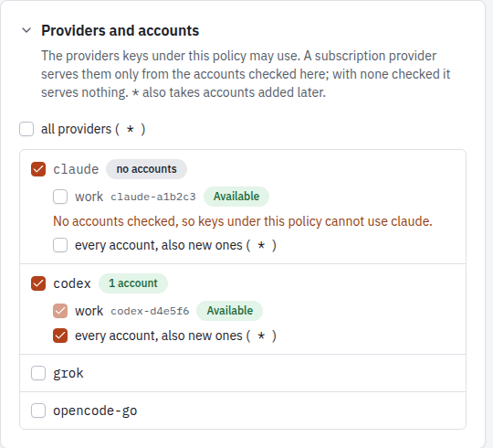

Every client authenticates with its own client key (`xol_...`). Every key
belongs to a policy. The policy decides what the key can do.

## Write a policy

A policy is a TOML or JSON file:

```toml
name = "devcontainer"
description = "Coding agents in devcontainers"

providers = ["claude", "codex", "grok", "opencode-go", "vercel"]
rules = [
  { allow = "codex/gpt-6-codex" },
  { deny = "*-preview" },
]
precedence = ["claude", "codex", "grok", "opencode-go", "vercel"]

[accounts]
codex = ["codex-1a2b3c4d5e"]
claude = ["*"]
grok = ["*"]
opencode-go = ["*"]

[models]
"codex/gpt-6-codex-mini" = false

[winners]
"kimi-k3" = "vercel"

[renames]
"opencode-go/claude-haiku-5-5" = "haiku-go"

[aliases]
"fast" = ["codex/gpt-6-codex-mini", "vercel/openai/gpt-6-mini"]

[limits]
requests_per_minute = 60
tokens_per_day = 5000000
```

```sh
xolotl policies put devcontainer.toml
xolotl policies list
xolotl policies get devcontainer
xolotl policies delete devcontainer   # refused while keys use it
```

The web UI's policy editor has the same fields. It lists the providers with
the accounts of each subscription provider. Its model list has two modes:
**Rules** edits the rules in order, the default for other models, and the
aliases; **Effective models** shows every model of the allowed providers as the
policy decides it, with a switch per model, inline renames, the winner of each
shared name, and the state of the accounts the policy uses. A model's switch
writes `models`.

| Field | Meaning |
|---|---|
| `name` | Lowercase letters, digits, `-` and `_`, at most 63 characters |
| `description` | Free text |
| `providers` | Providers the key can use: `claude`, `codex`, `grok`, `opencode-go`, gateway provider names, or `*` for all |
| `accounts` | Per subscription provider, the accounts that serve the keys, or `["*"]` for every account, also accounts added later. See [Accounts](#accounts) |
| `rules` | Allow and deny globs on `model` or `provider/model`, in order: `{ allow = "…" }` or `{ deny = "…" }`. The first that matches decides. See [Model names](#model-names) |
| `models` | `provider/model` → `true` or `false`, for models no rule matches |
| `deny_other_models` | `true` denies a model that no rule matches and `models` does not list. Default `false` |
| `precedence` | Provider order for a model name that several providers serve |
| `winners` | Per-model provider choice, before `precedence` |
| `renames` | `provider/model` → the name keys see instead of its plain name |
| `aliases` | Extra names. Each maps to one `provider/model`, or to a list tried in order |
| `scopes` | What the key can do. Default `["proxy"]` |
| `mcp_servers` | MCP servers the key can use through `/mcp`, or `*` |
| `allow_tools`, `deny_tools` | Globs on `tool` or `server/tool`. Deny wins. See [MCP gateway](mcp-gateway#policies) |
| `key_policies` | With the `keys` scope, the policies whose client keys the key can manage. See [Issue keys from a script](#issue-keys-from-a-script) |
| `limits` | Request and token limits on the LLM endpoints, also per provider and per account. See [Rate limits](#rate-limits) |

### Scopes

| Scope | Allows |
|---|---|
| `proxy` | The LLM endpoints (`/v1/...`) and the passthroughs |
| `mcp` | The MCP gateway at `/mcp` |
| `management` | The T3 Code hubs endpoints (`/v0/management/...`) |
| `keys` | Issue, revoke, disable and list client keys under the policies in `key_policies` |
| `admin` | The admin API, the same as the bootstrap admin token |

A policy that allows MCP servers or lists `key_policies` needs no `providers`.

### Accounts

A subscription provider serves a policy's keys from the accounts listed under
`accounts`:

```toml
[accounts]
codex = ["codex-1a2b3c4d5e", "codex-f6a7b8c9d0"]   # only these two
claude = ["*"]                                    # every account, also new ones
```

- A provider without an entry has no accounts: its requests get a 403. An empty
  list is the same as no entry. In the web UI, a provider you turn on starts
  with the accounts it has now.
- Saving a policy still succeeds in that case, but tells you. `xolotl policies put`
  prints a warning to stderr, `PUT /admin/policies/{name}` adds a `warnings` list
  to its answer, and the web UI's policy editor shows the warning under the
  provider. `PUT` ignores `warnings` in its input, so a saved answer can be sent
  back. Each warning names one subscription provider. `providers = ["*"]`
  allows them all, so it warns for each one with no entry. A policy whose scopes
  don't include `proxy` or `admin` gets no warning, as its keys call no provider.
- `xolotl accounts list` shows the account IDs.
- When none of the listed accounts exists, a request gets a 403. When the
  listed accounts are disabled, cooling down or at a limit, the pool answers
  as it does for a pool with no usable accounts.



### Policies from before 0.4.0

Version 0.4.0 replaced `allow_models` and `deny_models` with `rules`, and added
`accounts`. Xolotl migrates a stored policy that has either old field each time
it loads the policy, with the same effect:

- Each `deny_models` glob becomes a `deny` rule, followed by each
  `allow_models` glob as an `allow` rule.
- `deny_other_models` is `true` when `allow_models` had entries.
- `accounts` gets `["*"]` for each subscription provider the policy allows.

The migration is in memory, and Xolotl logs it once per policy. The record in
OpenBao stays as it is until you save the policy, so `xolotl policies get` shows
the migrated form and OpenBao shows the old one. To store the migrated form, save
the policy in the web UI, or with `xolotl policies get` and `xolotl policies put`.
A version before 0.4.0 can't read a policy saved this way.

Xolotl can't tell a policy from before 0.4.0 that has neither old field from a
current policy that uses no accounts, so it leaves that policy as it is, and it
loses its subscription accounts in the upgrade. Its keys still work for gateway
providers, and get a 403 from each subscription provider. To restore access,
add `accounts` and save the policy:

```sh
xolotl policies get devcontainer > devcontainer.json
# Add, for each subscription provider the policy uses:
#   "accounts": { "claude": ["*"], "codex": ["*"] }
xolotl policies put devcontainer.json
```

`xolotl policies put` and `PUT /admin/policies/{name}` take the current fields
only. Rewrite an old policy file before you save it.

### Policies that do not load

A stored policy that Xolotl can't read or parse is not in use. Its keys get a
`401 invalid API key`, and Xolotl logs the client and the policy at warn level
for each refused request. The policy shows up:

- as a warning from `xolotl policies list`, on stderr
- with its error from `xolotl policies get <name>` and `xolotl policies view <name>`
- in `unloaded_policies` of `GET /admin/status`
- under **Needs action** on the web UI's Overview page, and on its Policies page

To repair it, save a valid policy with the same name.

## Model names

A client sends a model name. The policy turns it into one or more targets
(`provider/model`):

1. Xolotl keeps each model in the catalog whose provider is allowed and that
   the policy allows: the first rule that matches decides, else its `models`
   entry, else `deny_other_models` (allowed when it is not set). To make an
   exception to a rule, put a rule for the exact `provider/model` above it.
2. When several providers serve the same name, one provider wins the plain
   name: the one in `winners`, else the first in `precedence`, else the first
   in the default order `claude`, `codex`, `grok`, `opencode-go`, else
   alphabetical. The other providers do not get the plain name.
3. Renames are added. A renamed model does not take part in step 2, so its
   plain name goes to the next provider that serves it. A rename does not
   allow a model: a denied model stays hidden.
4. Aliases are added. An alias or a rename with the same spelling as a plain
   name replaces it. An alias and a rename can't have the same name, and two
   models can't be renamed to the same name.

The `provider/model` form always works for a model the policy allows, also for
a model that lost its plain name.

An alias with a list is a fallback chain: on a 429 or 5xx, xolotl tries the next
target.

### Example

The catalog has `claude-haiku-5-5` on `claude` and on `opencode-go`. With the
default order, a key sees `claude-haiku-5-5` on `claude`. The OpenCode Go copy
is still `opencode-go/claude-haiku-5-5`, or `haiku-go` with the rename above.
`fast` tries a Codex model first and a Vercel model when Codex answers with a
429 or 5xx.

### See what a key sees

```sh
xolotl policies view devcontainer
```

This lists every name, where it routes, and the endpoints it is served on,
natively and through translation. It lists the accounts that exist now and that
keys can use for each subscription provider the policy allows, and says
`no accounts` where there are none. With MCP servers, it also lists the tools a
key can call. A client gets the same names from `GET /v1/models`.

## Rate limits

A policy can limit how much its keys use the LLM endpoints, in total and per
provider or account:

```toml
[limits]
per = "key"                  # or "policy": all keys of the policy share one allowance
requests_per_minute = 60
requests_per_day = 5000
tokens_per_minute = 200000
tokens_per_day = 5000000

[limits.providers.vercel]    # requests sent to one provider
tokens_per_day = 1000000

[limits.accounts.codex-1a2b3c4d5e]   # requests sent to one account
requests_per_day = 500
```

Every field is optional. A missing limit is no limit. A limit must be at least
1; to block a key, disable it.

| Limit | Counts |
|---|---|
| `requests_per_minute`, `requests_per_day` | Requests to `/v1/...`, `/backend-api/codex/...`, the passthroughs and `/opencode-go/...`. An alias that falls back to its next target counts once |
| `tokens_per_minute`, `tokens_per_day` | Input plus output tokens, as the upstream reports them. Input includes cache reads and writes |

- **Windows** slide: a minute is the last 60 seconds, a day the last 24 hours.
- **Per key or per policy.** With `per = "key"` (default) each key has its own
  allowance. With `per = "policy"` all keys of the policy share one. `per`
  applies to the provider and account limits too.
- **Provider limits** count the requests sent to the provider. When a
  provider is at its limit, an alias tries its next target; the last target
  answers 429. A provider limit names a provider the policy allows.
- **Account limits** count the requests sent to the account, also one that
  fails over to another account. An account at its limit is skipped and the
  pool serves from its other accounts. When every account is at a limit, the
  request gets a 429. An account limit names an account the policy uses.
  After a restart, each logged request counts on the account that answered it.
- **Tokens are counted when the response finishes.** A token limit is checked
  before each request, so the request that goes over the limit still
  completes. The next one is refused.
- **Refused requests do not count**, so a client that retries gets through as
  soon as the window allows.
- **Not limited:** `GET /v1/models`, `/mcp`, the management and admin APIs, and
  the bootstrap admin token.
- **No spend limits.** Xolotl counts requests and tokens, not money.

A request over a limit gets a 429 with `Retry-After`, the seconds until the
limit admits a request again. The error names the limit, and says whether it
counts the key or the policy.

To count tokens in a streamed Chat Completions request, xolotl asks the
upstream for its usage chunk (`stream_options.include_usage`). The client then
gets one extra chunk with empty `choices`, also if it did not ask for it.

Counters are kept in memory and rebuilt from the request log of the last
24 hours when xolotl starts. Each instance counts only its own requests.

`xolotl keys list` shows each key's consumption per window, and the web UI
shows it on the **Policies** and **Client keys** screens. The **Policies**
screen also shows the consumption of each provider and account limit. The metrics are
`xolotl.limit.consumption` and `xolotl.limit.rejections` (see
[Telemetry](telemetry)).

## Issue a client key

```sh
xolotl keys issue --policy devcontainer --name laptop --ttl 90d \
  --description "Laptop devcontainer"
```

The key is written to OpenBao at `keys/<policy>/<name>`, field `api_key`. It is
never printed. The client reads it with its own OpenBao policy, scoped to that
one path:

```hcl
path "secret/data/xolotl/keys/devcontainer/laptop" { capabilities = ["read"] }
```

```sh
export XOLOTL_API_KEY=$(bao kv get -field=api_key secret/xolotl/keys/devcontainer/laptop)
```

The web UI's **Client keys** screen shows the path, the `bao` command and the
OpenBao policy for each key.

A key issued on one instance works on another at once: an unknown key makes
xolotl reload keys from OpenBao, at most every 10 seconds.

## Manage keys

```sh
xolotl keys list
xolotl keys rotate devcontainer/laptop --grace 1h   # the old key works for 1 more hour
xolotl keys disable devcontainer/laptop
xolotl keys enable devcontainer/laptop
xolotl keys revoke devcontainer/laptop
```

- **Rotate** writes a new key to the same path. Without `--grace`, the old key
  stops at once.
- **Revoke** writes a revocation marker and destroys every earlier version of
  the record, so nobody can recover the key from history. You can then issue a
  new key with the same name.
- **Issue** on a name that has a live key changes nothing. It reports that the
  key exists. To replace the key, rotate it.
- **Revoke** on a key that is already revoked, or that does not exist, is not an
  error.

The `USAGE` column of `xolotl keys list` shows requests per minute, requests per
day, tokens per minute and tokens per day. A window the policy limits shows
`used/limit`, for example `7/60`. With `per = "policy"`, the limited windows
show the total of all keys of the policy, and the column ends with `(policy)`.

Durations are numbers with `s`, `m`, `h`, `d` or `w`, for example `30m` or `90d`.

## Issue keys from a script

A tool that provisions clients does not need the admin token. Give it a key from
a policy with the `keys` scope, and name the policies it may issue under:

```toml
name = "provisioner"
description = "Issues keys for new workspaces"
scopes = ["keys"]
key_policies = ["workspaces"]
```

```sh
xolotl policies put provisioner.toml
xolotl keys issue --policy provisioner --name robot
```

The client reads that key from OpenBao, as with any other key, and sends it as
its bearer token.

| The key can | The key can't |
|---|---|
| `POST /admin/keys` under a listed policy | Change, read or delete a policy |
| `GET /admin/keys`, which shows only the keys of listed policies | Reach accounts, providers, MCP servers, usage or status |
| `DELETE /admin/keys/<policy>/<name>` | Enable or rotate a key |
| `POST /admin/keys/<policy>/<name>/disable` | Use the LLM endpoints, unless its policy also has `proxy` |

`key_policies` names each policy. It has no wildcard, and a policy can't list
itself. Give each host or tool its own policy to issue under, so that it can't
reach the keys of another.

A key can't manage keys of a listed policy that has any scope other than `proxy`
or `mcp`. Such a key could do more than the key that issued it. The request gets
a 403, also if you change the listed policy later. The same applies to a listed
policy that did not load, because its scopes can't be read.

### Safe to repeat

A script can send each request again after a timeout or a failure. Neither
request ever returns a key.

**`POST /admin/keys`** with `policy` and `name`, and optionally `description` and
`ttl_secs`. Without `ttl_secs`, the key does not expire.

| Answer | `status` | Meaning |
|---|---|---|
| 201 | `created` | A new key is in OpenBao at `vault_path` |
| 200 | `exists` | A live key has this name, and nothing changed. The other fields are the stored key's, also if the request asked for another description or lifetime. Check `disabled` and `expires_at` |
| 400 | | The name is not valid, the policy does not exist, or `ttl_secs` is out of range |
| 403 | | The key may not manage keys of this policy |
| 409 | | Another Xolotl instance is changing this key. Send it again |
| 500 | | OpenBao failed. Send it again: a key that was written is reported as `exists` |

A name whose key was revoked can be issued again, which gives `created`.

**`DELETE /admin/keys/<policy>/<name>`**

| Answer | `status` | Meaning |
|---|---|---|
| 200 | `revoked` | The key is revoked, and every earlier version is destroyed |
| 200 | `already_revoked` | It was revoked before. Xolotl destroyed the earlier versions again |
| 200 | `absent` | No record, or its latest version has no data. Xolotl destroyed any versions it kept |
| 500 | | OpenBao failed, and a version may still hold the key. Send it again |

After a 200, no version in OpenBao holds the key. A revoked key's record stays as
a marker without a key.

### Who did it

The log names the caller of each change as `actor`: the client ID of the key, or
`admin` for the bootstrap admin token and web UI sessions. The log has one line
for each issue, including an answer of `exists`, and for each revoke, disable,
enable and rotate. A request outside `key_policies` logs a warning with `actor`,
`policy` and `action`. Keys are not in the log.

```text
INFO issued client key client=workspaces/a actor="provisioner/robot"
```

## Usage by client

```sh
xolotl usage --group-by client --since 7d
```

Group by `client`, `account`, `provider` or `model`. The table shows requests,
errors, and input, output and cached tokens.

Narrow the rows with `--client`, `--account`, `--provider` or `--model`:

```sh
xolotl usage --group-by model --client devcontainer/laptop
xolotl usage --group-by client --account ""   # gateway requests (no account)
```

An empty value matches rows that have no value there: `--client ""` is the
bootstrap admin token, `--account ""` gateway requests, `--model ""` requests
without a model.

On the web UI's **Usage** screen, select a row to narrow the view to it. The
view then groups by the next of model, account, client and provider that is not
shown or narrowed yet. Each filter shows as a chip that you can remove, and the
URL keeps the filters.
